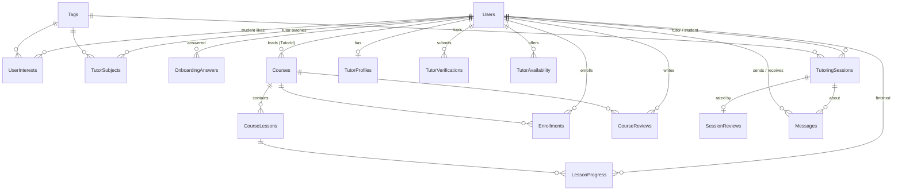

# Meowlet Education database

Everything about the database behind the Meowlet Education web app: how to set it up, what every table holds, how the tables connect, the sample data, and the rules to follow when you change it.

- **Engine:** SQL Server LocalDB, the copy that ships with Visual Studio 2022 (`(localdb)\MSSQLLocalDB`, SQL Server 2019)
- **Database name:** `MeowletEducation`
- **Access from code:** plain ADO.NET (`System.Data.SqlClient`), connection string `MeowletDb` in `Web.config`
- **Scripts:** `MeowletEducation/App_Data/`

| File | What it does |
|---|---|
| `setup-db.cmd` (repo root) | Builds or updates the database, then loads sample data |
| `App_Data/CreateDatabase.sql` | Schema: tables, constraints, indexes, views, procedure, topic tags |
| `App_Data/SeedData.sql` | Sample users, courses, lessons, progress, reviews, tutoring data |
| `App_Data/SampleQueries.sql` | Copy-paste queries for every feature, including tutoring |

---

## 1. Setup

### First time (every teammate)

1. Install Visual Studio 2022 with the **ASP.NET and web development** workload. LocalDB and `sqlcmd` come with it.
2. From the repo root, run:

   ```
   setup-db.cmd
   ```

3. You should see two summary tables (counts are listed in [section 6](#6-sample-data)) and `Done.`
4. Run the site from Visual Studio. `Web.config` already points to the database:

   ```
   Data Source=(localdb)\MSSQLLocalDB;Initial Catalog=MeowletEducation;Integrated Security=True
   ```

### Day to day

| You want to | Run |
|---|---|
| Pick up schema changes a teammate pushed | `setup-db.cmd` |
| Throw away your local data and start clean | `setup-db.cmd reset` |
| Look at the data in Visual Studio | **View > SQL Server Object Explorer > (localdb)\MSSQLLocalDB > Databases > MeowletEducation** |
| Run a query | Right-click the database > **New Query**, paste from `SampleQueries.sql`, then **Ctrl+Shift+E** |

`setup-db.cmd` is safe to run again and again:

- It only creates what is missing.
- It upgrades older databases in place, for example by adding new columns.
- It only inserts sample rows that are not there yet.

Your own test data is never touched unless you pass `reset`.

### Why not a shared `.mdf` file?

Each developer has their own LocalDB database. Git shares the scripts, not the database file, so everyone rebuilds the same database from the same scripts. A binary `.mdf` in git can't be merged, gets locked while Visual Studio has it open, and goes stale as soon as one person changes it.

---

## 2. Big picture

The database has three areas, plus helpers:

1. **Accounts and onboarding.** Who someone is and what they told us when they signed up.
2. **Courses and learning.** Self-paced courses made of lessons, with enrollments, progress and reviews.
3. **Tutoring.** Verified tutors, their availability, 1-on-1 bookings, session reviews and messages.
4. **Helpers.** Two views and one stored procedure that save you from repeating complex queries.

There is one `Users` table for everyone. `Users.Role` decides whether a row is a `Student`, a `Tutor` or an `Admin`. Tables that only apply to tutors (such as `TutorProfiles`) or only to students point back at `Users`.

### Entity-relationship diagram



### What the app uses today

| Table / object | Used by the app now | Notes |
|---|---|---|
| Users, Tags, UserInterests, TutorSubjects, OnboardingAnswers, AdminAccessRequests | Yes | Sign-up, sign-in, onboarding, profile, admin |
| Courses, Enrollments | Yes | Admin dashboard |
| CourseLessons, LessonProgress, CourseReviews | **Not yet** | Ready for the course player and the dashboard Reviews tab (which still shows sample rows) |
| TutorProfiles, TutorVerifications, TutorAvailability, TutoringSessions, SessionReviews, Messages | **Not yet** | Ready for the tutor feature |
| vw_TutorDirectory, vw_CourseStats, usp_DeleteUser | **Not yet** | Helpers for the above |

---

## 3. Conventions

Follow these when you add or change anything.

- **Names.** Tables are plural PascalCase (`TutoringSessions`). Keys are `<Thing>Id`. Constraints are named: `PK_`, `FK_`, `UQ_`, `CK_`, `DF_`, `IX_` (index), `UX_` (unique index).
- **Schema.** Everything lives in `dbo`. Code may write `dbo.Users` or just `Users`; both work.
- **Times are UTC.** Every `DATETIME2` column stores UTC and defaults to `SYSUTCDATETIME()`. Convert to Malaysia time (UTC+8) only when you display it: `DATEADD(HOUR, 8, col)` in SQL, or `.ToLocalTime()` / `TimeZoneInfo` in C#. The one exception is `TutorAvailability`, which stores wall-clock times in Malaysia time, because "Tuesdays 7–10 pm" is a local-time idea.
- **Fixed lists.** Fixed sets of values are `NVARCHAR` columns with a `CHECK` constraint (for example `Role`, `Status`), not lookup tables. To add a value, change the `CHECK` in `CreateDatabase.sql` and add an upgrade step (see [section 8](#8-changing-the-schema)).
- **Passwords.** Stored as an SHA-256 hash in lowercase hex (`CHAR(64)`), with no salt. This matches `HashPassword()` in the `.aspx.cs` files. In SQL: `LOWER(CONVERT(CHAR(64), HASHBYTES('SHA2_256', CAST(@pwd AS VARCHAR(100))), 2))`.
- **Booleans.** `BIT`, named `Is...` / `Has...`.
- **Parameters.** Always use `SqlParameter` (`@Email`), never string concatenation.
- **`QUOTED_IDENTIFIER` must be ON** for any connection that writes to `TutoringSessions`, because that table has a filtered unique index. ADO.NET and Visual Studio already turn it on. The `sqlcmd` tool doesn't, which is why `setup-db.cmd` passes `-I`.

---

## 4. Tables

`PK` = primary key, `FK` = foreign key, `UQ` = unique. "Default" is the value used when you leave the column out of an `INSERT`.

### 4.1 Accounts and onboarding

#### `Users`

Every account: students, tutors and admins.

| Column | Type | Null | Default | Notes |
|---|---|---|---|---|
| UserId | INT IDENTITY | no | | PK |
| FullName | NVARCHAR(100) | no | | |
| Email | NVARCHAR(256) | no | | UQ. Used to sign in |
| PasswordHash | CHAR(64) | no | | SHA-256 lowercase hex |
| Role | NVARCHAR(20) | no | | `Student`, `Tutor` or `Admin` |
| IsActive | BIT | no | 1 | 0 = deactivated by an admin; sign-in is refused |
| HasOnboarded | BIT | no | 0 | 1 once onboarding is finished |
| Institution | NVARCHAR(200) | yes | | Tutors: issuer of their certificate |
| CertificatePath | NVARCHAR(400) | yes | | Tutors: latest uploaded file, e.g. `App_Data/Certificates/4_20260918071738.jpg` |
| IsVerified | BIT | no | 0 | Tutors: 1 once an admin approves the certificate |
| CreatedAt | DATETIME2 | no | now | |
| DeleteRequestedAt | DATETIME2 | yes | | Set when the user asks to delete their account (Profile page). Cleared if they cancel or sign in again |

- **Rules:** a user can always be deactivated (`IsActive = 0`) instead of deleted. To delete someone permanently, use `dbo.usp_DeleteUser` ([section 5](#5-views-and-stored-procedure)).
- **Current state vs history:** `IsVerified` and `CertificatePath` hold the tutor's *current* verification state. The full history is in `TutorVerifications`.

#### `Tags`

The money topics used everywhere: student interests, tutor subjects and session topics. Seeded by `CreateDatabase.sql`.

| Column | Type | Notes |
|---|---|---|
| TagId | INT IDENTITY | PK |
| TagName | NVARCHAR(50) | UQ. Stable key used in code |
| DisplayLabel | NVARCHAR(100) | Shown to users |

| TagName | DisplayLabel |
|---|---|
| budgeting | Budgeting |
| saving | Saving |
| investing | Investing |
| debt | Debt Management |
| taxes | Taxes |
| insurance | Insurance |
| retirement | Retirement Planning |

`Courses.Category` is plain text, not a link to `Tags`. The admin dashboard also offers a `Fintech` category, which has no tag.

#### `UserInterests` (students) and `TutorSubjects` (tutors)

Many-to-many links between users and tags. Both tables have the same shape:

| Column | Type | Notes |
|---|---|---|
| UserId | INT | PK (together with TagId), FK → Users, cascade delete |
| TagId | INT | PK (together with UserId), FK → Tags, cascade delete |

#### `OnboardingAnswers`

Answers to the sign-up and onboarding questions, stored as key/value pairs so questions can change without schema changes.

| Column | Type | Notes |
|---|---|---|
| UserId | INT | PK (together with QuestionKey), FK → Users, cascade delete |
| QuestionKey | NVARCHAR(50) | See below |
| AnswerValue | NVARCHAR(100) | See below |

The valid keys and values are defined in code (`Signup.aspx`, `Onboarding.aspx.cs`):

| Who | QuestionKey | AnswerValue options |
|---|---|---|
| Student | `age_range` | `under_18`, `18_24`, `25_34`, `35_plus` |
| Student | `experience_level` | `beginner`, `some_basics`, `confident` |
| Student | `learning_goal` | `save_money`, `pay_debt`, `start_investing`, `retirement_plan`, `just_curious` |
| Student | `time_commitment` | `under_1h`, `1_3h`, `3h_plus` |
| Student | `learning_style` | `video`, `reading`, `one_on_one`, `no_preference` |
| Tutor | `years_experience` | `under_1y`, `1_3y`, `3y_plus` |
| Tutor | `teaching_format` | `one_on_one`, `group`, `either` |
| Tutor | `student_capacity` | `1_2`, `3_5`, `5_plus` |
| Tutor | `student_level` | `beginner`, `some_basics`, `no_preference` |

#### `AdminAccessRequests`

An admin sign up waiting for approval. `AdminSignup.aspx` writes only this row, not `Users`. Existing admins see it under the bell in the admin dashboard (`AdminNotifications.ashx`), generate a one-time code and send it on. The new admin enters it on `AdminAccessCode.aspx`; a match inserts the `Users` row (Role `Admin`) and deletes this row in one transaction. Declining deletes the row.

| Column | Type | Notes |
|---|---|---|
| RequestId | INT | PK, identity |
| FullName | NVARCHAR(100) | |
| Email | NVARCHAR(256) | Unique |
| PasswordHash | CHAR(64) | SHA-256 hex, copied to `Users` on approval |
| RequestedAt | DATETIME2 | UTC, set on sign up |
| CodeHash | CHAR(64) | SHA-256 hex of the current code; NULL before one is generated |
| CodeExpiresAt | DATETIME2 | UTC, 24 hours after generating |
| GeneratedBy | INT | Admin who generated the code. No FK, so deleting that admin never blocks |
| GeneratedAt | DATETIME2 | UTC |
| FailedTries | INT | Wrong codes entered; 5 locks the code until a new one is generated (which resets it) |

### 4.2 Courses and learning

#### `Courses`

| Column | Type | Null | Default | Notes |
|---|---|---|---|---|
| CourseId | INT IDENTITY | no | | PK |
| CourseCode | NVARCHAR(20) | no | | UQ. Upper case, e.g. `BUD101` |
| Title | NVARCHAR(200) | no | | |
| Category | NVARCHAR(100) | no | | Budgeting, Saving, Investing, Debt Management, Taxes, Insurance, Retirement Planning, Fintech |
| Level | NVARCHAR(20) | no | | Beginner, Intermediate, Advanced |
| Lessons | INT | no | 0 | **Planned** lesson count typed by the admin. The real lessons are in `CourseLessons` |
| IsPublished | BIT | no | 0 | Unpublished courses are hidden from learners |
| CreatedAt | DATETIME2 | no | now | |
| Description | NVARCHAR(1000) | yes | | Short blurb for the course card |
| TutorId | INT | yes | | FK → Users. The tutor who leads the course. No cascade; `usp_DeleteUser` clears it |
| ImageUrl | NVARCHAR(400) | yes | | Cover picture path, e.g. `assets/img/courses/bud101.jpg` (seeded Pexels photo) or `assets/img/courses/uploads/<guid>.jpg` (uploaded in the admin dashboard). NULL shows a placeholder |

The category and level lists live in `admindashboard.aspx.cs` (`CourseCategories`, `CourseLevels`). Deleting a course also deletes its lessons, enrollments, progress and reviews.

#### `CourseLessons`

| Column | Type | Null | Default | Notes |
|---|---|---|---|---|
| LessonId | INT IDENTITY | no | | PK |
| CourseId | INT | no | | FK → Courses, cascade delete |
| Position | INT | no | | 1, 2, 3, ... Unique within a course (`UQ_CourseLessons_Position`) |
| Title | NVARCHAR(200) | no | | |
| ContentType | NVARCHAR(20) | no | | `Video`, `Article`, `Quiz` |
| ContentUrl | NVARCHAR(400) | yes | | Video link |
| Body | NVARCHAR(MAX) | yes | | Article text or quiz JSON |
| DurationMinutes | INT | no | 10 | > 0 |

#### `Enrollments`

A learner taking a course.

| Column | Type | Null | Default | Notes |
|---|---|---|---|---|
| UserId | INT | no | | PK (together with CourseId), FK → Users, cascade |
| CourseId | INT | no | | PK (together with UserId), FK → Courses, cascade |
| EnrolledAt | DATETIME2 | no | now | Drives the dashboard's enrollments chart |
| CompletedAt | DATETIME2 | yes | | Set when the learner finishes every lesson |

#### `LessonBlocks`

What is inside a lesson. The admin course builder (`AdminCourse.aspx`) calls lessons "chapters"; each chapter holds an ordered list of blocks. Saved through `AdminCourseApi.ashx`.

| Column | Type | Null | Default | Notes |
|---|---|---|---|---|
| BlockId | INT | no | identity | PK |
| LessonId | INT | no | | FK → CourseLessons, cascade. Changes when a block is moved to another chapter |
| Position | INT | no | | Order inside the chapter, from 1 |
| BlockType | NVARCHAR(10) | no | | `Text`, `Media` or `Quiz` |
| MediaKind | NVARCHAR(10) | yes | | `Image` or `Video`, Media blocks only |
| MediaUrl | NVARCHAR(400) | yes | | A link (YouTube, Vimeo, any https file) or an upload in `assets/media/lessons/` |
| Body | NVARCHAR(MAX) | yes | | Text: the content. Media: the caption. Quiz: `{"questions":[{"q":"...","options":["..."],"answer":0}]}` |
| CreatedAt | DATETIME2 | no | now | UTC |

`Courses.Lessons` is kept equal to the number of chapters by the builder, so nobody types it any more.

#### `LessonProgress`

One row per lesson a learner has finished. No row means not done yet.

| Column | Type | Notes |
|---|---|---|
| UserId | INT | PK (together with LessonId), FK → Users, cascade |
| LessonId | INT | PK (together with UserId), FK → CourseLessons, cascade |
| CompletedAt | DATETIME2 | Default now |

To get % complete: `COUNT(LessonProgress rows for that course) / COUNT(CourseLessons in that course)`. See "Continue learning" in `SampleQueries.sql`. When the count reaches 100 %, set `Enrollments.CompletedAt`.

#### `CourseReviews`

What learners think of a course. This is the data for the admin dashboard's **Reviews** tab.

| Column | Type | Null | Default | Notes |
|---|---|---|---|---|
| ReviewId | INT IDENTITY | no | | PK |
| UserId | INT | no | | FK → Users, cascade |
| CourseId | INT | no | | FK → Courses, cascade |
| Rating | TINYINT | no | | 1–5 |
| Comment | NVARCHAR(1000) | yes | | |
| IsHidden | BIT | no | 0 | Hidden by an admin (spam, abuse). Excluded from averages |
| CreatedAt | DATETIME2 | no | now | |

`UQ_CourseReviews_UserCourse` allows one review per learner per course. To change a review, use `UPDATE`.

### 4.3 Tutoring

#### How a tutor goes from sign-up to teaching

```
SignupTutor.aspx     Users row (Role = Tutor, IsVerified = 0, CertificatePath)
                     + TutorVerifications row (Status = Pending)          ← to wire up
Onboarding           TutorSubjects + OnboardingAnswers
Profile              TutorProfiles (headline, bio, meeting link) + TutorAvailability
Admin approves       TutorVerifications.Status = Approved, Users.IsVerified = 1
                     → tutor appears in vw_TutorDirectory and can be booked
```

#### `TutorProfiles`

One row per tutor: the public details students see.

| Column | Type | Null | Default | Notes |
|---|---|---|---|---|
| UserId | INT | no | | PK, FK → Users, cascade |
| Headline | NVARCHAR(150) | no | | One line under their name |
| Bio | NVARCHAR(2000) | yes | | |
| MeetingLink | NVARCHAR(400) | yes | | Default Meet/Zoom/Teams link for their sessions |
| IsAcceptingStudents | BIT | no | 1 | 0 = still listed but not taking new bookings |
| UpdatedAt | DATETIME2 | no | now | Set it on every update |

#### `TutorVerifications`

Every certificate a tutor submits and what an admin decided. This keeps the full history, such as "rejected for a blurry scan, then approved".

| Column | Type | Null | Default | Notes |
|---|---|---|---|---|
| VerificationId | INT IDENTITY | no | | PK |
| TutorId | INT | no | | FK → Users, cascade |
| CertificatePath | NVARCHAR(400) | no | | File under `App_Data/Certificates/` |
| Institution | NVARCHAR(200) | yes | | |
| Status | NVARCHAR(20) | no | `Pending` | `Pending`, `Approved`, `Rejected` |
| SubmittedAt | DATETIME2 | no | now | |
| ReviewedByUserId | INT | yes | | FK → Users (the admin) |
| ReviewedAt | DATETIME2 | yes | | |
| ReviewNote | NVARCHAR(500) | yes | | Shown to the tutor on rejection |

`CK_TutorVerifications_Reviewed` requires that `ReviewedAt` is empty while `Pending` and filled once `Approved` or `Rejected`.

When an admin decides, update both tables in one transaction:
- the `TutorVerifications` row
- `Users.IsVerified` (and `Users.CertificatePath` on a new upload)

`SampleQueries.sql` has the exact statements.

#### `TutorAvailability`

Recurring weekly slots when a tutor can teach.

| Column | Type | Notes |
|---|---|---|
| AvailabilityId | INT IDENTITY | PK |
| TutorId | INT | FK → Users, cascade |
| DayOfWeek | TINYINT | 1 = Monday ... 7 = Sunday |
| StartTime | TIME(0) | **Malaysia local time** |
| EndTime | TIME(0) | Must be after StartTime |

`UQ_TutorAvailability_Slot` is unique on (TutorId, DayOfWeek, StartTime).

- **Day numbering:** SQL Server's `DATEPART(WEEKDAY, ...)` depends on the `DATEFIRST` setting. Convert with `(DATEPART(WEEKDAY, @d) + @@DATEFIRST - 2) % 7 + 1` to get Monday = 1.
- **C#:** `((int)date.DayOfWeek + 6) % 7 + 1` gives the same numbering.

#### `TutoringSessions`

A 1-on-1 booking.

| Column | Type | Null | Default | Notes |
|---|---|---|---|---|
| SessionId | INT IDENTITY | no | | PK |
| TutorId | INT | no | | FK → Users (no cascade) |
| StudentId | INT | no | | FK → Users (no cascade). Must differ from TutorId |
| TagId | INT | yes | | FK → Tags. The topic |
| StartsAt | DATETIME2 | no | | **UTC** |
| DurationMinutes | INT | no | 60 | 15–240 |
| Status | NVARCHAR(20) | no | `Requested` | See lifecycle below |
| StudentNote | NVARCHAR(1000) | yes | | What the student wants help with |
| TutorNote | NVARCHAR(1000) | yes | | Tutor's summary or homework afterwards |
| MeetingLink | NVARCHAR(400) | yes | | Overrides `TutorProfiles.MeetingLink` for this session |
| CancelledByUserId | INT | yes | | FK → Users. Who cancelled |
| CreatedAt | DATETIME2 | no | now | |
| UpdatedAt | DATETIME2 | no | now | Set it on every status change |

Lifecycle:

```
Requested ──tutor accepts──▶ Confirmed ──session happens──▶ Completed ──▶ student may review
    │                           │
    ├──tutor says no──▶ Declined│
    └──either side──────────────┴──▶ Cancelled (CancelledByUserId = who)
```

- **No double booking:** `UX_TutoringSessions_TutorSlot` is a filtered unique index. It stops a tutor having two live sessions (`Requested`, `Confirmed` or `Completed`) that start at the same moment. Cancelled and declined sessions don't block the slot.
- **Not enforced by the database:** whether the slot fits the tutor's availability, and whether the tutor is verified and accepting students. Check both in code before you insert. `SampleQueries.sql` has the availability check.
- **Deleting users:** sessions don't cascade-delete with a user, because SQL Server doesn't allow two cascade paths from `Users`. Use `usp_DeleteUser`.

#### `SessionReviews`

The student's rating of a completed session. There is at most one per session.

| Column | Type | Notes |
|---|---|---|
| SessionId | INT | PK, FK → TutoringSessions, cascade |
| Rating | TINYINT | 1–5 |
| Comment | NVARCHAR(1000) | |
| IsHidden | BIT | Hidden by an admin; excluded from the tutor's average |
| CreatedAt | DATETIME2 | |

The reviewer and the tutor come from the session (`StudentId`, `TutorId`), so they aren't stored again. Only allow a review when the session's `Status = 'Completed'`.

#### `Messages`

Direct messages between two users, optionally about one session.

| Column | Type | Null | Notes |
|---|---|---|---|
| MessageId | INT IDENTITY | no | PK |
| SenderId | INT | no | FK → Users |
| RecipientId | INT | no | FK → Users. Must differ from SenderId |
| SessionId | INT | yes | FK → TutoringSessions. Set to NULL if the session is deleted |
| Body | NVARCHAR(2000) | no | |
| SentAt | DATETIME2 | no | Default now |
| ReadAt | DATETIME2 | yes | NULL = unread |

A conversation is all the messages where the two users are sender and recipient in either direction. See the "Inbox" query.

### 4.4 Indexes

Primary keys and unique constraints already have their own indexes. In addition:

| Index | On | Why |
|---|---|---|
| IX_Users_Role | Users (Role, IsActive, IsVerified) | Listing tutors and students |
| IX_Enrollments_CourseId | Enrollments (CourseId) | Learner counts per course |
| IX_LessonProgress_LessonId | LessonProgress (LessonId) | Progress per lesson |
| IX_CourseReviews_CourseId | CourseReviews (CourseId) | Ratings per course |
| IX_TutorVerifications_Tutor | TutorVerifications (TutorId, SubmittedAt) | Verification history |
| IX_TutoringSessions_Tutor | TutoringSessions (TutorId, StartsAt) | Tutor's schedule |
| IX_TutoringSessions_Student | TutoringSessions (StudentId, StartsAt) | Student's sessions |
| UX_TutoringSessions_TutorSlot | TutoringSessions (TutorId, StartsAt), filtered | No double booking |
| IX_Messages_Recipient | Messages (RecipientId, ReadAt, SentAt) | Inbox and unread counts |
| IX_Messages_Sender | Messages (SenderId, SentAt) | Sent messages |

### 4.5 What happens on delete

| Deleting a... | Also deletes | Blocked if... / handled by |
|---|---|---|
| User | Interests, subjects, answers, enrollments, progress, course reviews, tutor profile, verifications they submitted, availability | Blocked while they have sessions or messages, lead a course, or reviewed a verification. **Use `usp_DeleteUser`**, which clears these first |
| Course | Lessons, enrollments, progress on its lessons, reviews | Never blocked (admin dashboard **Delete**) |
| Lesson | Progress rows for it | |
| Tag | Interest and subject links | Blocked while a session uses the tag |
| Session | Its review. Linked messages keep existing with `SessionId = NULL` | |

---

## 5. Views and stored procedure

### `dbo.vw_TutorDirectory`

One row per **active, verified** tutor, with these columns:

- `UserId`, `FullName`, `Email`, `Institution`
- `Headline`, `Bio`, `IsAcceptingStudents`
- `Subjects` (comma-separated)
- `AvgRating`, `ReviewCount` (visible session reviews only)
- `CompletedSessions`

Use it to build the "Find a tutor" page:

```sql
SELECT * FROM dbo.vw_TutorDirectory WHERE IsAcceptingStudents = 1 ORDER BY AvgRating DESC;
```

### `dbo.vw_CourseStats`

One row per course, with these columns:

- `CourseId`, `CourseCode`, `Title`, `Category`, `Level`, `IsPublished`
- `TutorId`, `TutorName`
- `PlannedLessons` (from `Courses.Lessons`), `LessonCount` (actual rows in `CourseLessons`)
- `LearnerCount`, `CompletedCount`
- `AvgRating`, `ReviewCount`

### `dbo.usp_DeleteUser @UserId`

Permanently deletes a user in one transaction:

1. Removes their messages and sessions (session reviews go with the sessions).
2. Clears links where they appear as the canceller, the reviewing admin or a course's tutor.
3. Deletes the user. Everything else cascades.

Use it for the "delete account" queue (`Users.DeleteRequestedAt`):

```csharp
using (var cmd = new SqlCommand("dbo.usp_DeleteUser", conn))
{
    cmd.CommandType = CommandType.StoredProcedure;
    cmd.Parameters.AddWithValue("@UserId", userId);
    cmd.ExecuteNonQuery();
}
```

---

## 6. Sample data

`SeedData.sql` fills the database with a small but realistic Malaysian cast. All sample emails end in `@tutor.meowlet.test` or `@student.meowlet.test`, so they're easy to spot and to filter out.

### Sign-in accounts

| Who | Email | Password |
|---|---|---|
| Admin | `meowlet@meowletedu.com` | `Meowmeowmeow` |
| sohyewen | `tp078275@mail.apu.edu.my` | `sohyewen` |
| Everyone else | see below | `Meowlet123!` |

### Tutors

| Name | Email | State | Subjects |
|---|---|---|---|
| Nurul Aina Hassan | nurul.aina@tutor.meowlet.test | Verified | Budgeting, Saving |
| Daniel Tan Wei Ming | daniel.tan@tutor.meowlet.test | Verified | Investing, Retirement |
| Priya Ramasamy | priya.r@tutor.meowlet.test | Verified (rejected once first) | Debt, Budgeting |
| Ahmad Faiz Ismail | ahmad.faiz@tutor.meowlet.test | Verified | Investing, Insurance |
| Grace Lim Hui Shan | grace.lim@tutor.meowlet.test | Verified, **not accepting students** | Taxes, Retirement |
| Kevin Lau Chee Keong | kevin.lau@tutor.meowlet.test | **Pending verification** | Investing, Saving |
| Siti Mariam Yusof | siti.mariam@tutor.meowlet.test | Unverified, **no certificate yet** | Insurance, Taxes |
| Marcus Wong | marcus.wong@tutor.meowlet.test | **Deactivated** (had a 2-star review) | Debt |

### Students

| Name | Email | Notes |
|---|---|---|
| Aisha Rahman | aisha.rahman@student.meowlet.test | Most active: 4 courses, 3 sessions, messages |
| Jason Ong | jason.ong@student.meowlet.test | Investor; partway through INV301 |
| Mei Ling Chua | meiling.chua@student.meowlet.test | Taxes and budgeting |
| Arjun Nair | arjun.nair@student.meowlet.test | Debt; had a session cancelled by the tutor and rebooked |
| Hafiz Zulkifli | hafiz.z@student.meowlet.test | Retirement and investing |
| Chloe Teo | chloe.teo@student.meowlet.test | Under 18 |
| Farah Nabilah | farah.n@student.meowlet.test | Cancelled one session herself |
| Ryan Goh | ryan.goh@student.meowlet.test | Investing |
| Kavitha Subramaniam | kavitha.s@student.meowlet.test | Has an unanswered booking request |
| Lucas Yap | lucas.yap@student.meowlet.test | Gave Marcus the 2-star review |
| Zara Iskandar | zara.i@student.meowlet.test | **Hasn't finished onboarding** |
| Brandon Lee | brandon.lee@student.meowlet.test | **Deactivated**; posted a spam review (hidden) |
| Nadia Kamal | nadia.kamal@student.meowlet.test | **Asked to delete her account** |
| sohyewen | tp078275@mail.apu.edu.my | Own password (see above); no courses yet |

### Counts after a fresh `setup-db.cmd reset`

| Users | Courses | Lessons | Enrollments | Lessons done | Course reviews |
|---|---|---|---|---|---|
| 23 (1 admin, 8 tutors, 14 students) | 12 (10 published) | 87 | 31 | 235 | 12 (1 hidden) |

| Tutor profiles | Verifications | Availability slots | Sessions | Session reviews | Messages |
|---|---|---|---|---|---|
| 8 | 8 | 16 | 21 | 9 | 9 |

### What's in it

- **Courses:** one or two per category. `FIN101` and `TAX301` are unpublished, and `TAX301` has no lessons yet.
- **Enrollments:** spread from March to October 2026, so the dashboard's 8-month chart has a shape.
- **Lesson progress:** follows a fixed rule (2 lessons a week since enrolling, measured up to 2026-10-06). Long-running enrollments are complete; recent ones are partway through.
- **Sessions:**
  - 11 completed, 9 of them reviewed
  - 2 cancelled (one by the student, one by the tutor) and 1 declined
  - 7 upcoming between 2026-10-07 and 2026-10-15: 4 confirmed, 3 requested
- **Upcoming dates are fixed.** Those sessions will be in the past once those dates pass. If you need fresh upcoming sessions, move the dates in `SeedData.sql` and run `setup-db.cmd reset`.
- **Certificates:** sample tutors point at the two files already in `App_Data/Certificates/`.

---

## 7. Common queries

`App_Data/SampleQueries.sql` has a working, commented query for each of these. Test queries that change data run inside `BEGIN TRANSACTION ... ROLLBACK`, so running the whole file changes nothing.

- **Accounts:** sign in (password hash check), list users, a user's answers and interests, the delete-request queue
- **Tutors:**
  - the directory, tutors by subject, one tutor's full profile
  - matching tutors to a student by shared topics, students who want 1-on-1 help
  - the verification queue, approving a tutor, tutors per subject
- **Courses:** the catalogue, a student's courses, enrollments per month, course stats, a lesson list with ticks, "continue learning" (% done and the next lesson), marking a lesson done, the admin Reviews tab
- **Tutoring:**
  - the directory, a weekly timetable, verification history
  - upcoming bookings (tutor view), all my sessions (student view)
  - booking with an availability check, and the status-change statements
  - the inbox with unread counts, low-rated sessions
  - safe user deletion

---

## 8. Changing the schema

1. **Edit `CreateDatabase.sql`, never just the live database.** Teammates only get changes that are in the script.
2. **Keep it re-runnable:**
   - **New table:** wrap it in `IF OBJECT_ID('dbo.X', 'U') IS NULL CREATE TABLE ...`
   - **New column on an existing table:** add it to the `CREATE TABLE` *and* add an upgrade step:
     ```sql
     IF COL_LENGTH('dbo.Users', 'PhoneNumber') IS NULL
         ALTER TABLE dbo.Users ADD PhoneNumber NVARCHAR(30) NULL;
     GO
     ```
     New columns on existing tables should be `NULL` or have a `DEFAULT`, so old rows stay valid.
   - **Index:** `IF NOT EXISTS (SELECT 1 FROM sys.indexes WHERE name = 'IX_...') CREATE INDEX ...`
   - **View or procedure:** `CREATE OR ALTER`
   - **Changing a `CHECK` list:** `ALTER TABLE ... DROP CONSTRAINT CK_...;` then `ALTER TABLE ... ADD CONSTRAINT CK_... CHECK (...)`. Guard the pair so it only runs when the definition is old.
3. **Put a `GO` after any `ALTER TABLE ... ADD`** before a later statement uses the new column.
4. **Add sample rows to `SeedData.sql`.** Match on a natural key (email, course code, ...) with `WHERE NOT EXISTS`, so the script stays re-runnable.
5. **Test all three paths:**
   - `setup-db.cmd` on your existing database (upgrade)
   - `setup-db.cmd` again (should add nothing)
   - `setup-db.cmd reset` (fresh build)
6. **Update this file.**

---

## 9. Troubleshooting

| Symptom | Fix |
|---|---|
| `Cannot open database "MeowletEducation" requested by the login` | You haven't built it yet. Run `setup-db.cmd` |
| `'sqlcmd' is not recognized` | Install the Visual Studio **Data storage and processing** workload, or the [sqlcmd tool](https://learn.microsoft.com/sql/tools/sqlcmd/sqlcmd-utility), then open a new terminal |
| `setup-db.cmd reset` hangs or says the database is in use | Close query windows on it in Visual Studio, or stop the site. The script forces single-user mode, which usually handles this |
| `INSERT failed because the following SET options have incorrect settings: 'QUOTED_IDENTIFIER'` | You ran a script with `sqlcmd` without `-I`. Use `setup-db.cmd`, or add `-I` |
| `Invalid column name 'DeleteRequestedAt'` (or another new column) | Your database is older than the code. Run `setup-db.cmd` |
| `The DELETE statement conflicted with the REFERENCE constraint` when deleting a user | Use `EXEC dbo.usp_DeleteUser @UserId` |
| `Cannot insert duplicate key row ... UX_TutoringSessions_TutorSlot` | That tutor already has a live booking starting at that time |
| LocalDB won't start | `sqllocaldb stop MSSQLLocalDB` then `sqllocaldb start MSSQLLocalDB`. As a last resort: `sqllocaldb delete MSSQLLocalDB`, `sqllocaldb create MSSQLLocalDB`, `setup-db.cmd` |
